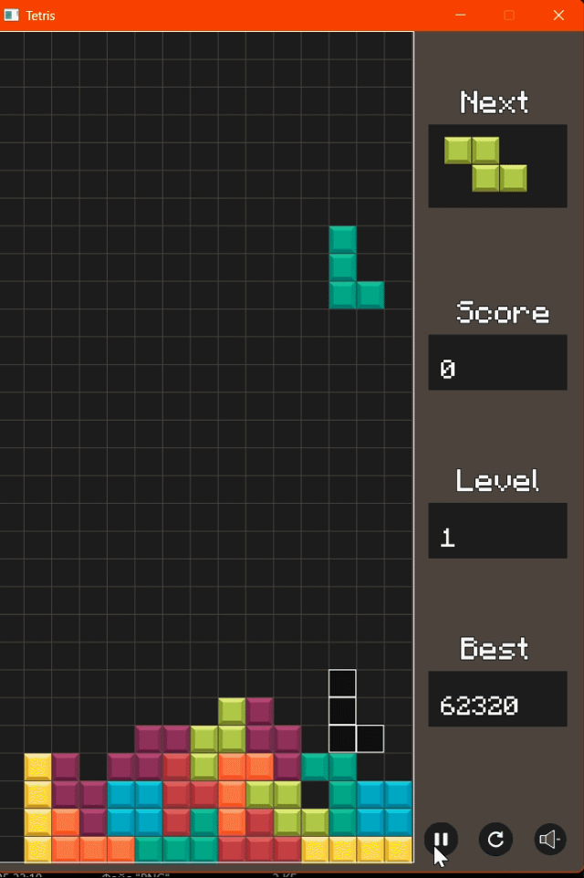

# Функциональное назначение программы

Простейшая игра "Тетрис"

# Демонстрация работы

# Сборка и запуск

* Склонируйте или скачайте репозиторий.
* Откройте папку "запуск игры"
* Запустите файл tetris.exe

# Руководство

## Перемещение фигур
Используйте клавиши-стрелочки "влево", "вправо", "вниз" для перемещения фигуры.

## Сброс фигур вниз
Используйте клавишу "пробел" для быстрого сброса фигуры вниз.

## Поворот фигур
Используйте клавишу-стрелочку "вверх" для поворота фигуры

## Пауза, рестарт, отключение звука на панели
Используйте ЛКМ для активации/деактивации
